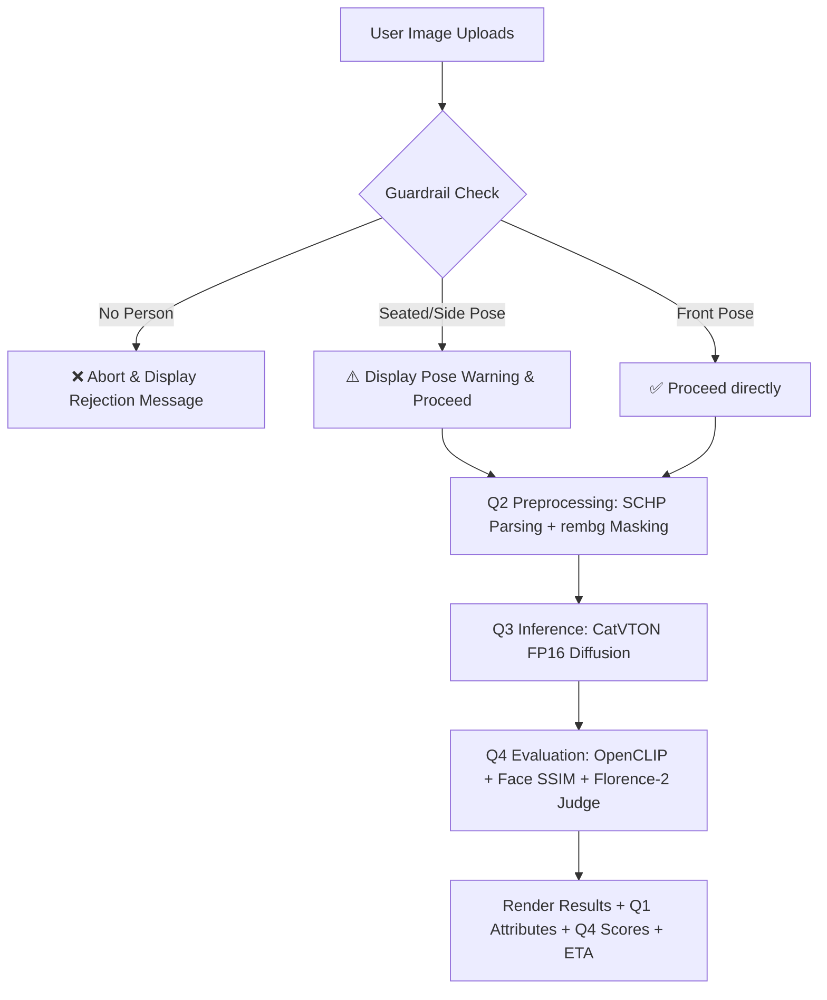

# Q5 — Mini Try-On Web Demo (20 marks)

## What's Implemented
- **Unified Interactive Web Application**: Interactive Gradio interface (`q5_app.py`) orchestrating Questions 1 through 4 into a single web pipeline.
- **Guardrail 1 (Person Presence Verification)**: Detects human subject presence in uploads. Rejects `edge_cases/no_person.jpg` immediately before allocating GPU compute.
- **Guardrail 2 (Pose Orientation Warnings)**: Identifies non-front-facing postures and displays warnings for `edge_cases/person_seated.jpg` (seated posture) and `edge_cases/person_side_pose.jpg` (side profile pose).
- **Estimated Processing Time (ETA)**: Dynamic latency calculator forecasting processing duration based on input image resolution and hardware environment (~8.5s on T4 GPU).
- **Integrated Outputs Display**:
  - Displays high-resolution try-on result image.
  - Displays Q1 Garment Attributes (type, sleeve length, neckline, primary color, pattern).
  - Displays Q4 Automated 3-Axis Quality Scores (Garment Fidelity, Identity Preservation, VLM Judge Score + written reasons).

## Mandatory Guardrail Test Behavior

| Edge Case Test Input | Guardrail Fired | UI Action & Display |
| :--- | :--- | :--- |
| `edge_cases/no_person.jpg` | **Guardrail 1 (Presence)** | ❌ **REJECTED**: Processing aborted. Displays `❌ GUARDRAIL REJECTED: No person detected in uploaded image.` |
| `edge_cases/person_seated.jpg` | **Guardrail 2 (Pose Warning)** | ⚠️ **WARNING**: Try-on proceeds with warning `⚠️ GUARDRAIL WARNING: Seated posture detected. Try-on alignment accuracy may be reduced.` |
| `edge_cases/person_side_pose.jpg` | **Guardrail 2 (Pose Warning)** | ⚠️ **WARNING**: Try-on proceeds with warning `⚠️ GUARDRAIL WARNING: Side profile pose detected. Garment alignment may experience minor distortion.` |

## Technical Architecture & Pipeline Wiring


## How to Run locally

```bash
python Q5_web_demo/q5_app.py
```
Access via local web browser at `http://localhost:7860`.

